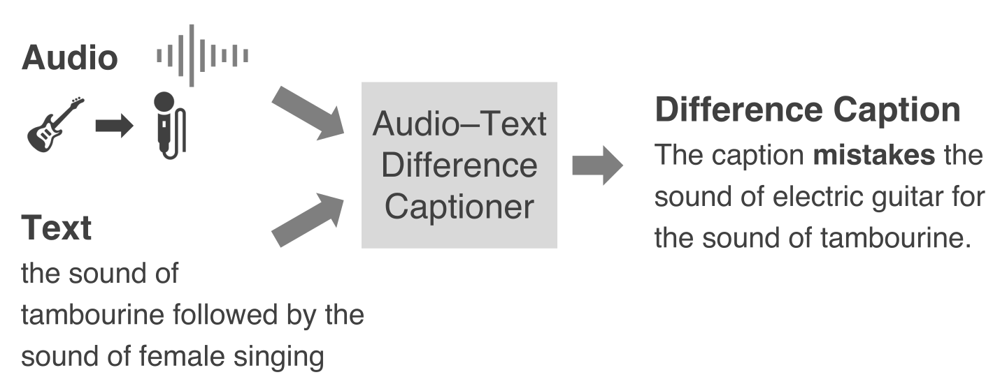
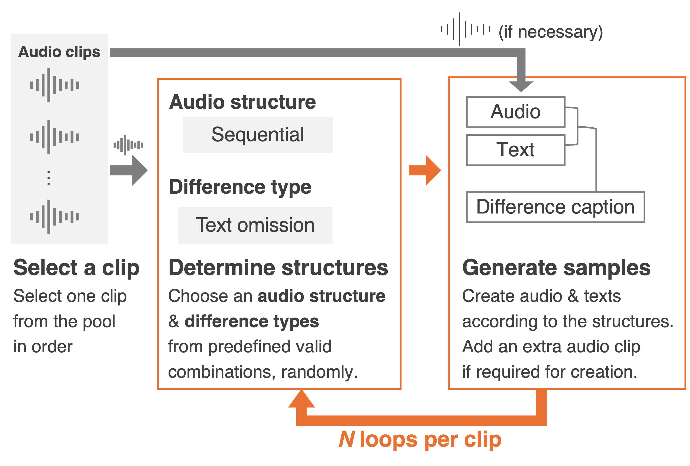

# AT-DIFFER

This repository contains the dataset and the experiment code of the paper
"AT-DIFFER: Dataset for Audio–Text Difference Captioning" by Akihiro Fujii,
Yuki Okamoto, Yuki Saito, and Hiroshi Saruwatari.

With it, you can rebuild the AT-DIFFER dataset used in the paper, fine-tune
[Qwen3-Omni-30B-A3B-Thinking](https://huggingface.co/Qwen/Qwen3-Omni-30B-A3B-Thinking)
on it (Methods 1–3), and run the Baseline and the fine-tuned models on its
test split.

<p align="center">
  
</p>

## Task: audio–text difference captioning

Audio–text difference captioning is the task of generating a caption that
describes how a text differs from the audio it is paired with, instead of
rating their agreement with a single score. In the example above, the text
names a tambourine where the audio has an electric guitar, and the difference
caption states this.

The models in this repository solve three tasks in one response: difference
detection (whether the audio and the text differ), difference type
classification, and difference captioning. They receive the audio and the
prompt [`resources/prompt.txt`](resources/prompt.txt) with the text inserted,
and output three lines:

```
DISCREPANCY: 1
TYPES: event_omission
EXPLANATION: The caption leaves out the sound of screaming that is actually present.
```

The TYPES line uses the type names of the prompt, which differ from the names
of the difference types in the paper (see [Dataset](#dataset)).

## Dataset

AT-DIFFER consists of audio–text pairs with systematically simulated
differences, each with a reference difference caption. The audio is made from
clips of FSD50K-Solo [[1]](#references), the subset of
[FSD50K](https://zenodo.org/records/4060432) [[2]](#references) whose clips
contain a single sound event. As shown below, six different combinations of
an audio structure and difference types are chosen at random from the valid
ones for each clip (N = 6 in the figure), and a pair is made for each of them.
A simultaneous or sequential pair uses a second clip, also chosen at random.
The texts and difference captions are made from templates filled with FSD50K
labels: those of the clips and, for a semantic difference or a sound omission,
the label of a sound event absent from the audio, chosen at random.

<p align="center">
  
</p>

Each pair has one of three **audio structures**:

- **Single**: one sound event.
- **Simultaneous**: two clips superimposed, so that the two sound events occur
  at the same time.
- **Sequential**: two clips concatenated, so that one sound event follows the
  other.

Each pair has one or two of the following **difference types**, or none
("no difference", with the difference caption "The caption accurately
describes the audio."):

| Difference type | What differs | Difference caption template |
|---|---|---|
| Semantic difference | A sound event in the audio is described as a different one. | The caption mistakes the sound of [correct event] for the sound of [wrong event]. |
| Text omission | A sound event in the audio is missing from the text. | The caption leaves out the sound of [absent event] that is actually present. |
| Sound omission | A sound event in the text is absent from the audio. | The caption adds the sound of [nonexistent event] that is not actually there. |
| Sequential discrepancy | The order of two sequential sound events is reversed in the text. | The caption reverses the order of [event A] and [event B]. |
| Simultaneity discrepancy | The text describes sequential sound events as simultaneous, or the reverse. | The caption describes the sequential [event A] and [event B] as overlapping. / The caption describes the simultaneous [event A] and [event B] as sequential. |

The prompt and the output format are kept exactly as in the paper's
experiments, so they use names that differ from those in the paper and in the
dataset metadata. The prompt calls the text "caption", as the difference
captions do, and the TYPES line uses the following type names:

| Difference type | Type names on the TYPES line |
|---|---|
| Semantic difference | `event_omission` and `phantom_sound` |
| Text omission | `event_omission` |
| Sound omission | `phantom_sound` |
| Sequential discrepancy | `swapped_order` |
| Simultaneity discrepancy | `overlap` |

A semantic difference has no type name of its own: the text misses the sound
event in the audio and names one that is absent from it, so it is written as
both `event_omission` and `phantom_sound`. A pair with no difference has
`DISCREPANCY: 0` and `TYPES: none`. This mapping is defined in
[`resources/taxonomy.yaml`](resources/taxonomy.yaml).

The splits follow those of FSD50K: train and val are made from the FSD50K dev
set, and test from the FSD50K eval set.

| Split | Pairs | Single | Simultaneous | Sequential |
|---|---:|---:|---:|---:|
| train | 149,172 | 30,770 | 51,279 | 67,123 |
| val | 14,466 | 3,034 | 4,941 | 6,491 |
| test | 33,642 | 6,982 | 11,604 | 15,056 |

The audio is not distributed. [`dataset/metadata/`](dataset/metadata/) holds
the metadata of every pair (the text, the difference caption, the labels, and
the FSD50K clips its audio is made from), and the
[dataset stage](dataset/README.md) re-renders the audio from FSD50K, identical
to that used in the paper.

## Repository structure

```
AT-DIFFER/
├── assets/      # Images for this README
├── resources/   # Prompt, label vocabulary, and output format shared by the stages
├── dataset/     # Re-renders AT-DIFFER from the bundled metadata and FSD50K audio
├── finetune/    # LoRA fine-tuning of Qwen3-Omni (Methods 1–3) and merging of the adapter
├── inference/   # Inference of the Baseline and Methods 1–3 on the test split
└── outputs/     # Default location of the base model, checkpoints, and predictions (not tracked by Git)
```

Each stage is a separate Python project with its own environment, managed by
[uv](https://docs.astral.sh/uv/), and its own README. The stages pass data to
each other only through files.

## Requirements

All stages need [uv](https://docs.astral.sh/uv/).

| Stage | Platform | Disk space |
|---|---|---|
| [dataset](dataset/README.md) | Any (CPU only) | 126 GB for the audio, in addition to FSD50K |
| [finetune](finetune/README.md) | Linux with NVIDIA GPUs and a driver that supports CUDA 13.0 | 63 GB for the base model, about 32 GB for an audio cache, and 63 GB for each merged checkpoint |
| [inference](inference/README.md) | Linux x86_64 with NVIDIA GPUs and a driver that supports CUDA 13.0 | The base model and the merged checkpoints |

The CUDA 13.0 requirement comes from the environments pinned in `uv.lock`,
which use the CUDA 13.0 builds of PyTorch, as in the paper's runs. Inference
is limited to Linux x86_64 because vLLM and decord have no packages for other
platforms. See the README of each stage for the other requirements (e.g.,
`nvcc` on Blackwell GPUs for inference, and about 70 GB of memory for merging
the adapter).

### Tested environment

The fine-tuning and inference code was run only in the environment of the
paper: one node with two NVIDIA RTX PRO 6000 Blackwell Max-Q Workstation
Edition GPUs (96 GB each).

- The configs and defaults assume two GPUs. Fine-tuning makes the effective
  batch size of 32 from 1 per GPU × 16 gradient accumulation steps × 2 GPUs,
  and inference uses a tensor parallel size of 2 (`--tensor-parallel-size`).
  Other numbers of GPUs have not been tested.
- Fine-tuning keeps a full copy of the model (bf16) on each GPU, so each GPU
  needs memory for the model and the activations. Only GPUs with 96 GB were
  tested.
- The audio re-rendered by the dataset stage was verified to be identical to
  that of the paper on macOS (arm64). On other platforms, small numerical
  differences may occur.

## Usage

First, clone this repository:

```bash
git clone https://github.com/sarulab-speech/AT-DIFFER.git
cd AT-DIFFER
```

Then run the stages in order, starting each step from the root of the
repository. The commands below are for the Baseline and Method 2. The README
of each stage describes all options and the outputs, and those of finetune and
inference also give example Slurm job scripts (`scripts/slurm/`).

### 1. Build the dataset

Download and extract `FSD50K.dev_audio` and `FSD50K.eval_audio` from
[Zenodo](https://zenodo.org/records/4060432), then run:

```bash
cd dataset
uv sync
uv run at-differ-dataset \
    --dev-audio-dir  /path/to/FSD50K.dev_audio \
    --eval-audio-dir /path/to/FSD50K.eval_audio \
    --output-dir     /path/to/AT-DIFFER
```

This creates `train/`, `val/`, and `test/` under `/path/to/AT-DIFFER`, each
with `metadata.csv` and `audios/`.

### 2. Fine-tune

```bash
cd finetune
uv sync

# Base model, at the revision used in the paper
uv run hf download Qwen/Qwen3-Omni-30B-A3B-Thinking \
    --revision 2f443cfc4c54b14a815c0e2bb9a9d6cbcd9a748b \
    --local-dir ../outputs/models/Qwen3-Omni-30B-A3B-Thinking

# 16 kHz audio cache and training manifests
uv run at-differ-finetune prepare \
    --dataset-dir  /path/to/AT-DIFFER \
    --cache-dir    ../outputs/finetune/cache \
    --manifest-dir ../outputs/finetune/manifests

# Train, then merge the LoRA adapter into the base model
uv run torchrun --nproc_per_node 2 -m at_differ_finetune.train --config configs/method2.yaml
uv run at-differ-finetune merge \
    --adapter ../outputs/finetune/method2/adapter \
    --out     ../outputs/finetune/method2/merged
```

The methods differ only in which output lines are supervised and how their
losses are combined:

| Method | Config | Loss |
|---|---|---|
| Method 1 (Difference caption only) | `configs/method1.yaml` | Cross-entropy over the EXPLANATION line |
| Method 2 (Concatenate three tasks) | `configs/method2.yaml` | One cross-entropy over all three lines |
| Method 3 (Separate three tasks) | `configs/method3.yaml` | Cross-entropy of each line, combined with equal weights |

### 3. Run inference

```bash
cd inference
uv sync
export FORCE_QWENVL_VIDEO_READER=decord

# Baseline
uv run at-differ-inference \
    --data-dir   /path/to/AT-DIFFER/test \
    --output-dir ../outputs/inference/baseline

# Method 2
uv run at-differ-inference \
    --data-dir   /path/to/AT-DIFFER/test \
    --output-dir ../outputs/inference/method2 \
    --model      qwen3-omni-nothink \
    --model-path ../outputs/finetune/method2/merged
```

Each run writes `predictions.csv` (the model output for every test pair,
together with its metadata) and `run_metadata.yaml` (the settings of the run)
to a new run directory under `--output-dir`.

The Baseline needs only the dataset and the base model; if you skip step 2,
download the base model as described in the
[inference README](inference/README.md). The Baseline runs with thinking
enabled, as in the paper's Baseline results, whereas the fine-tuned models
start their response with an empty thinking block, as in fine-tuning.

## Citation

```bibtex
@article{fujii2026atdiffer,
  title        = {{AT-DIFFER}: Dataset for Audio--Text Difference Captioning},
  author       = {Fujii, Akihiro and Okamoto, Yuki and Saito, Yuki and Saruwatari, Hiroshi},
  year         = {2026},
}
```

## References

[1] N. Yang, S. Yin, L.-C. Yang, B. Irvin, X. Quan, M. Stamenovic, and
S. Zhang, "FSD50K-Solo: Automated Curation of Single-Source Sound Events,"
Proc. European Signal Processing Conference (EUSIPCO), 2026.
Paper URL: https://arxiv.org/abs/2605.13931,
Dataset URL: https://doi.org/10.5281/zenodo.20403806

[2] E. Fonseca, X. Favory, J. Pons, F. Font, and X. Serra, "FSD50K: An Open
Dataset of Human-Labeled Sound Events," IEEE/ACM Transactions on Audio,
Speech, and Language Processing, vol. 30, pp. 829–852, 2022.
Paper URL: https://doi.org/10.1109/TASLP.2021.3133208
